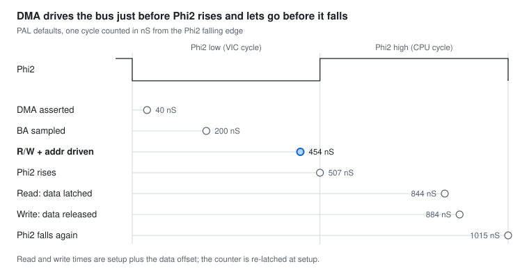

# DMA Timing vs Phi2 (Common_Defs.h)

### Note: Timing values as of 11/11/2026 / TR+ firmware v0.9
Every DMA byte is timed against one Phi2 cycle: the firmware latches a cycle counter at the Phi2 falling edge and waits fixed nanosecond offsets from it. The DMA values are all offsets from Phi2 falling; the two data values are measured from a second latch taken just before Phi2 rises.

Nominal Phi2 periods: PAL about 1015 nS (half about 507 nS), NTSC about 978 nS (half about 489 nS). The 50% duty cycle is an assumption, not a value in the header.

## Timing values

All times in nS, from the `Def_nS_*` constants in [Common_Defs.h](../../Source/Teensy/MinimalBoot/Common/Common_Defs.h). Rise and fall positions assume a 50% duty cycle.

| Value | Measured from | PAL | NTSC | NTSC C128 | Purpose |
| --- | --- | --- | --- | --- | --- |
| nS_DMAAssert | Phi2 fall | 40 | 40 | 40 | Assert DMA after the falling edge |
| nS_DMABAWait | Phi2 fall | 200 | 200 | 200 | Sample BA, decide whether to steal the cycle |
| nS_DMASetup | Phi2 fall | 454 | 430 | 459 | Drive R/W and address, near Phi2 rising |
| nS_DMADataSetup | Re-latch at setup | 390 | 404 | 375 | Latch the data bus on a DMA read |
| nS_DMADataHold | Re-latch at setup | 430 | 424 | 395 | Release the data bus on a DMA write |
| nS_KSenseSample | Re-latch at setup | 250 | 250 | 250 | Kernal Replace HIRAM sense (C128): sample ROMH in the stolen cycle |
| Phi2 period (nominal) | | 1015 | 978 | 978 | Reference |

Derived positions, from Phi2 fall in the same cycle:

| Event | PAL | NTSC | NTSC C128 |
| --- | --- | --- | --- |
| Setup, before Phi2 rises (half cycle minus setup) | about 53 | about 59 | about 30 |
| Read latch (setup + data setup) | 844 | 834 | 834 |
| Write release (setup + data hold) | 884 | 854 | 854 |
| Write release, before next Phi2 fall | about 131 | about 124 | about 124 |

## Timeline

DMA is asserted and BA checked while Phi2 is low. R/W and the address go out about 53 nS before Phi2 rises. The bus is read about 337 nS after the rise, or released after a write about 377 nS after it. NTSC has the same shape with 10 to 30 nS less on each value.

## How DMAByte() uses them

1. The caller latches `StartCycCnt` at Phi2 falling, then `DMAByte()` waits `nS_DMABAWait` and reads BA. If BA is low it returns and retries on the next cycle.
2. It presets the address bits, then waits `nS_DMASetup` with `WaitUntil_nS_fine`, so the drive lands within a few nS of the value whatever code ran before it. The coarse `WaitUntil_nS` used until 11/11/2026 landed 9 to 20 nS late, by an amount that changed with each build's code layout, and on an NTSC C64 the write window is about 25 nS wide (below).
3. It re-latches `StartCycCnt`. This is why `nS_DMADataSetup` and `nS_DMADataHold` are measured from setup, not from the falling edge.
4. A read waits `nS_DMADataSetup` and samples the data port. A write drives the data, waits `nS_DMADataHold`, then releases the bus.

Limits found in testing (comments in Common_Defs.h): a setup that is too early disturbs the VIC cycle (screen noise) and one too late gives write errors. On an NTSC C64 (Kawari) with the fine wait, the Teensy reads Phi2 high from a setup of about 415, earlier than the 50% assumption puts it, and writes fail from 440. Values measured before 11/11/2026 were taken with the coarse wait and drove about 14 nS later than they say; the PAL and NTSC C128 setups were raised by 14 to keep that drive point. On NTSC a data hold of 455 or more overruns the Phi2 fall and collapses. On PAL it collapses at 485. The NTSC C128 set exists because the C64 NTSC set gave intermittent write errors on a C128.

The set is chosen at runtime in IOHandlers.h (PAL by default, NTSC or NTSC C128 once the machine is detected). Non-DMA values such as `nS_DataSetup`, `nS_DataHold` and `nS_VICStart` are timed from the rising or falling edge directly and are not covered here.
